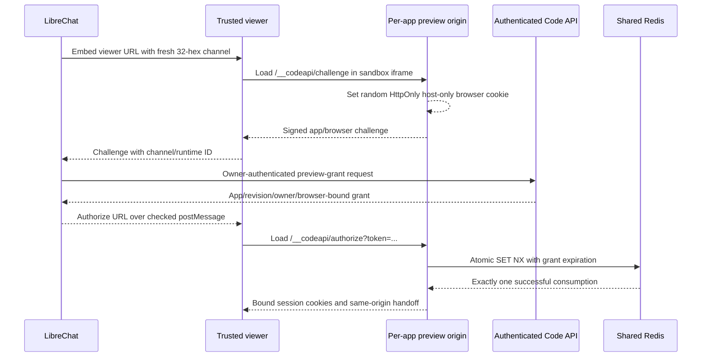

# Owner-only preview handoff maintenance

This overlay changes the experimental hosted-app preview handoff. It does not
change code execution, workspace checkpoint formats, VM launch policy or model
authentication. Infrastructure/Helm/image manifests belong in
`jaworldwideorg/oneja-ai-infrastructure`; application implementation belongs here.
The migration uses viewer `https://apps.oneja.ai`, a separate origin from
LibreChat, with a distinct `happ-<digest>.apps.oneja.ai` origin per owner/app.

## Browser and authenticated API contract



The viewer URL contains the opaque runtime ID and a caller-generated channel,
not a credential. Add `?channel=<32 lowercase hex>` when embedding it from
LibreChat. `CODEAPI_HOSTED_APP_PARENT_ORIGIN` must be the exact HTTPS origin
(`https://oneja.ai` in this deployment), with no path, query or credentials.
The parent checks `event.origin`, `event.source`, channel and runtime ID before
authorizing. The viewer checks both parent and child origins/window identities.
It forwards only one bounded challenge and accepts one authorization per opening;
app code cannot drive the privileged broker after the initial handoff. Opening
retry requires a fresh viewer/channel. Close the viewer and remove listeners
on logout, account change and canceled opening; reject stale async authorization
results belonging to a prior user/channel.
Authorization URLs must use the exact per-app origin and authorize path.

The authenticated grant endpoint receives:

```json
{"runtime_session_hint":"server-resolved workspace hint","challenge":"signed browser challenge"}
```

It derives the workspace/app identity from the authenticated principal and
checks the current record's owner, revision and deadline. It never takes an
owner ID from the browser. The challenge proves possession of the per-app
browser cookie separately from API principal authorization. A valid grant in a
different browser fails before consumption. A used grant cannot replay across
API replicas. Redis failure or an ambiguous consume leaves authorization
closed: request a fresh grant instead of retrying the old URL automatically.

Version-2 challenge/grant/session purposes are signed separately in token claims. Old
transferable tokens and a session presented as a grant are rejected. Session
and browser cookies use `__Host-`, Secure, HttpOnly, Path=/ and SameSite=Strict;
neither uses Domain. Authorization refreshes both cookie lifetimes without
changing the browser binding. App revision replacement and hard lease expiry
invalidate preview access. Never persist grants/cookies in messages, database
records, logs, analytics or Git; keep them in the live handoff only.

## Viewer isolation and release gates

The trusted viewer loads only its exact per-app origin. The app iframe and app
responses apply `sandbox allow-scripts allow-forms allow-same-origin`; the app
and viewer are different origins, so same-origin scripting does not grant
access to the viewer or LibreChat DOM. Origin-Agent-Cluster prevents domain
relaxation of the app/viewer origins. Popup/top navigation privileges are not
granted. Workers, child frames, external browser fetches and arbitrary upstream
cookie/security headers remain blocked by the existing proxy policy. Trusted
parent/viewer ancestors are explicitly allowed for the nested iframe. Both
bare viewer and wildcard app hosts terminate in preview handling and cannot
fall through into privileged Code API routes.

For a subdomain deployment, verify that LibreChat and related authentication
cookies are host-only and that signed authentication cannot accept a parent
domain cookie injected by generated code. A separate registrable domain is
still the upstream recommendation. Do not claim a subdomain provides that
registrable-domain isolation. Full browser checks must cover cookie scope,
cross-app denial, CSP, relative assets, fetch/forms, expiry/revision replacement,
refresh, canceled opening, reopened previews and upstream-header stripping.

This source overlay is prepared and tested locally; browser/BFF/frontend and
live AWS integration acceptance remain required. Do not enable the preview
feature merely because the backend builds. Roll API replicas to the same
overlay before exposing it; old replicas issue transferable v1 links and are
incompatible with the browser-bound gateway. During rollback, disable preview
admission first and retain VM/checkpoint records; never restore transferable
links as a fallback. Existing code execution can continue independently.

## Upstream merges and verification

Preserve the authentication/identity invariants in `router.ts`, purpose and
browser binding in `preview-access.ts`/`preview-grant.ts`, strict message-origin
and iframe policy in `preview-viewer.ts`, and atomic bounded one-use consumption
in `runtime-session/registry.ts`. Rebase against the deployed overlay base and
inspect upstream lifecycle/preview changes before reapplying patches. Retain
shared Redis consumption across replicas, generic client-safe errors and
exact record/revision/deadline checks. Do not replace distributed consumption
with process-local state or automatically retry ambiguous authorization.

From `service/`, with a dedicated local Redis available for module startup:

```sh
REDIS_HOST=127.0.0.1 REDIS_PORT=16379 bun test src/hosted-app/ src/runtime-session/registry.test.ts
bunx tsc --noEmit -p tsconfig.esm.json --pretty false
bunx eslint src/hosted-app/preview-grant.ts src/hosted-app/preview-viewer.ts src/hosted-app/preview-http.test.ts
```

The focused suites pass 111 tests, including real HTTP gateway requests,
different-browser/replay/wrong-owner/revision denial and 20 concurrent Redis
claims with exactly one winner. Use the repository's ESM typecheck config, also
used by the JA verified-release workflow; its CommonJS default rejects existing
import.meta and top-level-await files. These checks do not substitute for real browser/production
acceptance. Local fixture Redis must be isolated from production and cleaned
up afterwards; mock clients disconnect after each registry case.
